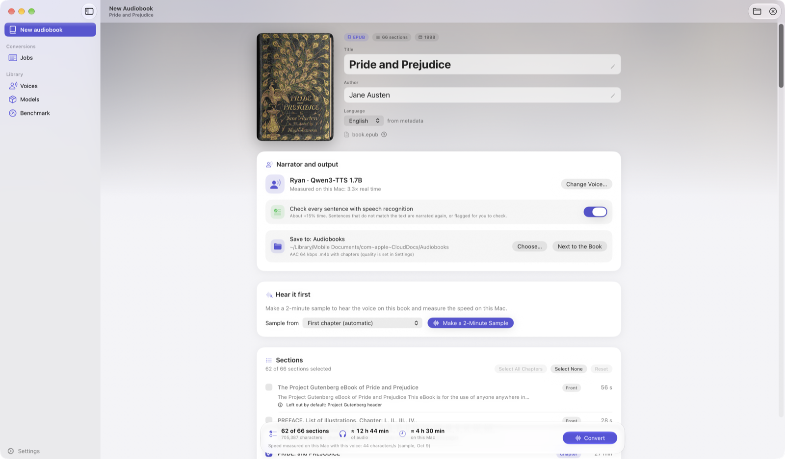
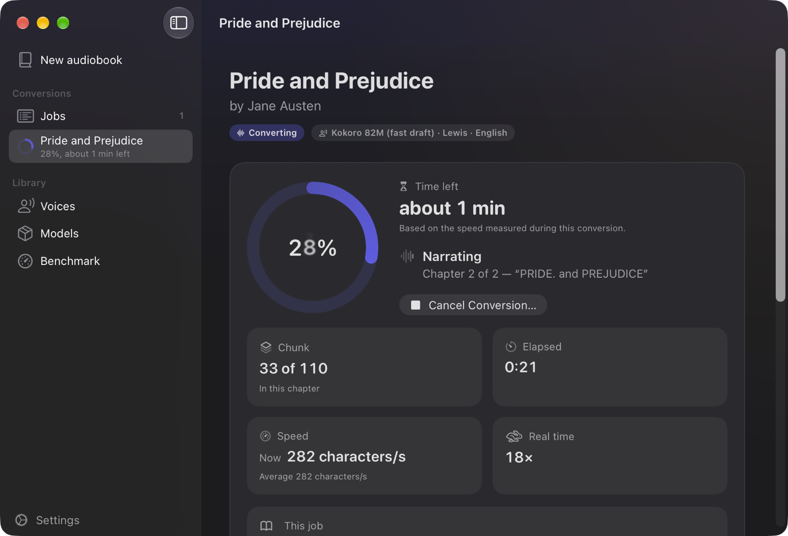
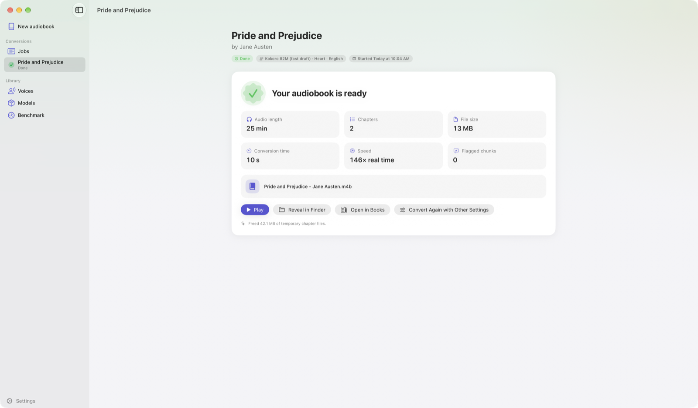
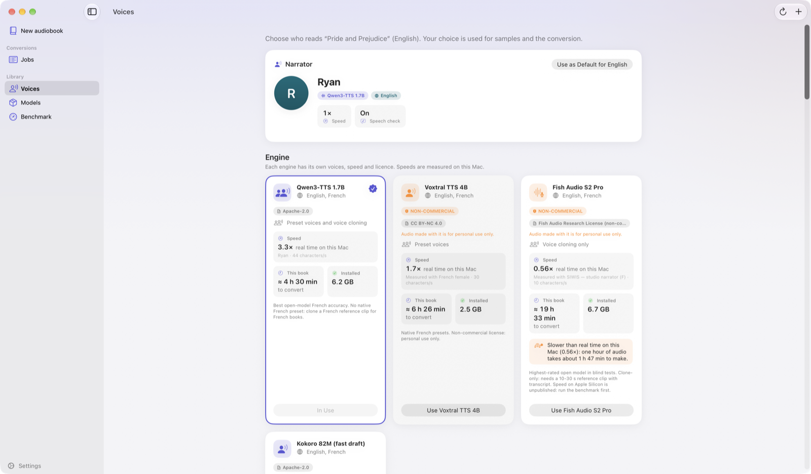

<div align="center">

# Audiobook Studio

### Turn any EPUB or PDF into a beautifully narrated audiobook — entirely on your Mac.

**No cloud. No subscription. No per-character fees. Your books never leave your computer.**

[**⬇ Download for macOS**](https://github.com/MeetVox-AI/audiobook-studio/releases/latest) · Apple Silicon · macOS 26 or later · free & open source



</div>

---

## Why you'll like it

|  |  |
|---|---|
| 🔒 **Private by design** | Narration runs on your Mac's GPU with open AI voice models. After the one-time model download it works offline. Nothing is uploaded, ever. |
| 🎧 **A real audiobook, not a long MP3** | One `.m4b` with chapter markers, cover art, title and author, normalised loudness and the audiobook tag, checked with ffprobe after every conversion, so audiobook players can show chapters and your cover. |
| 🗣️ **Voices you can actually pick** | Four engines, **13 languages**, plus **voice cloning** from a 10-second clip of a voice you have the right to use. Preview any voice on *your own book*, or compare two side by side. |
| ⏱️ **Honest time estimates** | Make a 2-minute sample first. The app measures how fast *your* Mac narrates, then tells you how long the whole book will take, and keeps a live, range-based estimate while it works. |
| ✅ **Checks its own work** | Every sentence is transcribed back with Whisper and compared with the text. Dropped or invented words are regenerated, and anything still wrong is listed for you. |
| 🔄 **Keeps itself up to date** | The app checks for new versions daily and installs them in the background (signed updates only). You can turn it off in Settings. |
| 🌙 **A proper Mac app** | Native SwiftUI, Liquid Glass design, light and dark mode. Conversions run in the background: close the window, quit the app, come back later. |

<div align="center">


</div>

## How it works

1. **Drop in a book.** An EPUB or a PDF with selectable text. Chapters are found from the table of contents; copyright pages, licences and indexes are left out for you, with the reason shown.
2. **Pick a narrator.** Browse voices, listen to a preview of *your* book's first paragraph, clone a voice if you like.
3. **Make a sample.** Hear two minutes and see the real time the full book will take.
4. **Press Convert.** Close the window if you want. You'll get a notification when the `.m4b` is ready.

<div align="center">

</div>

## Languages

English is on by default. **Add French and the other languages in Settings → Languages, only when you need them**: a language costs just its small reference voices (about 1–2 MB), because the voice models are shared by all languages and are installed once. The app tells you if a language needs an engine you have not installed (and its size) and never downloads a model without your say-so. Removing a language deletes its voices.

| | Languages |
|---|---|
| Qwen3-TTS (default engine) | English, French, Spanish, German, Italian, Portuguese, Russian, Chinese, Japanese, Korean |
| Voxtral | the above Latin-script ones plus Dutch, Hindi and Arabic |
| Kokoro (fast drafts) | English, French, Spanish, Italian, Portuguese, Hindi |

Every language was checked by narrating a test book and transcribing it back with Whisper. The text rules (numbers, abbreviations, chapter headings) for the non-English/French languages were written without native-speaker review, so please report anything that sounds wrong.

## How fast is it?

Measured on an Apple M4 Pro (48 GB), not quoted from a vendor. "×" means times faster than listening.

| Engine | Best for | Speed | Licence |
|---|---|---|---|
| **Kokoro 82M** | Fast drafts: English, French, Spanish, Italian, Portuguese, Hindi | ≈ 14–18× — a 6½-hour French novel in 32 minutes | Apache-2.0 |
| **Qwen3-TTS 1.7B** *(default)* | Best open quality: English, French, Spanish, German, Italian, Portuguese, Russian, Chinese, Japanese, Korean | ≈ 3–5× with preset voices, ≈ 2.4× when cloning, speech check included | Apache-2.0 |
| **Voxtral 4B** | Native presets in nine languages, including Dutch, Hindi and Arabic | ≈ 1.7–1.9× | CC BY-NC 4.0 (personal use) |
| **Fish S2 Pro** | Highest-fidelity cloning | ≈ 0.56× — slower than real time | Non-commercial |

Your Mac measures itself, so the app's estimates are for *your* machine.

## Install

**1. Download** the latest `AudiobookStudio-x.y.z.dmg` from the [Releases page](https://github.com/MeetVox-AI/audiobook-studio/releases/latest), open it and drag **Audiobook Studio** to Applications. The app is signed with a Developer ID and notarized by Apple.

**2. Open Audiobook Studio.** On first launch it sets up the narration engine for you: the app drives a local Python engine and the AI voice models, which are too large to ship inside the app. The setup installs `uv`, `ffmpeg` and `espeak-ng` with Homebrew if needed, puts the engine under `~/Library/Application Support/AudiobookStudio`, and downloads the models you choose, with every size shown first. You need an Apple Silicon Mac, macOS 26 or later, and [Homebrew](https://brew.sh).

If you prefer Terminal, the same [short script](scripts/install-engine.sh) does it (it also downloads the default models and four reference voices, about **12 GB**, one time):

```bash
curl -fsSL https://raw.githubusercontent.com/MeetVox-AI/audiobook-studio/main/scripts/install-engine.sh | bash
```

**3. Drop a book** on the window.

**Updates.** With automatic updates on (the default, Settings → About), new versions download in the background and install when you quit, and the engine is updated for you when a version needs it: nothing pops up. Meanwhile an **Update Now** button next to Settings restarts the app into the new version. With automatic updates off, that button and a banner are the only signs; ignore them and you keep your current version.

<details>
<summary><b>Build from source instead</b></summary>

Requirements: Apple Silicon Mac, macOS 26 or later, Xcode 26 command-line tools, Homebrew and about 12 GB free.

```bash
git clone https://github.com/MeetVox-AI/audiobook-studio.git
cd audiobook-studio
make setup        # installs tools, the engine, models and voices, and builds app/build/AudiobookStudio.app
make models-all   # optional: the non-commercial engines (Voxtral, Fish S2 Pro)
```

</details>

## Under the hood

```
AudiobookStudio.app (SwiftUI)  ──runs──▶  audiobook-engine (Python CLI, JSON lines on stdout)
                                          ├─ ingest: EPUB (TOC-anchored chapters) / PDF (outline, headings)
                                          ├─ text: en/fr normalisation (numbers, dates, currency, abbreviations)
                                          ├─ TTS: Kokoro · Qwen3-TTS · Voxtral · Fish S2 Pro (mlx-audio)
                                          ├─ QA: Whisper speech check, regenerates mismatched sentences
                                          └─ ffmpeg: loudness (−20 LUFS), AAC, chapters, cover → .m4b
```

The engine also works on its own from the terminal; the app is a thin front end over it.

## Use it from the terminal

```bash
E=engine/.venv/bin/audiobook-engine
$E inspect book.epub                                   # chapters, front/back matter, estimates
$E sample book.epub --engine qwen3 --voice ryan        # 60 s sample + projected time for the whole book
$E convert book.epub --engine qwen3 --voice ryan       # full audiobook, progress as JSON lines
$E convert livre.epub --engine qwen3 --ref-voice fr_siwis_female_book   # French, cloned narrator
$E convert book.epub --detach                          # background job; follow it with: $E jobs list
```

Every command prints JSON (one object per line). Re-running an interrupted conversion resumes where it stopped.

## Engines

| Engine | Languages | Voices | Licence | Speed on an M4 Pro* |
|---|---|---|---|---|
| Kokoro 82M | en, fr, es, it, pt, hi | 20 English presets; draft-quality voices for the others | Apache-2.0 | ≈ 14–18× real time |
| Qwen3-TTS 1.7B (default) | en, fr, es, de, it, pt, ru, zh, ja, ko | Native presets in English, Chinese, Japanese, Korean; any language by cloning | Apache-2.0 | ≈ 3–5× presets, ≈ 2.4× cloning |
| Voxtral 4B | en, fr, es, de, it, pt, nl, hi, ar | Presets in all nine (Arabic: one male voice) | CC BY-NC 4.0 (personal use) | ≈ 1.7–1.9× real time |
| Fish S2 Pro | en, fr (+78) | cloning only | Fish Audio Research Licence (non-commercial) | ≈ 0.56× (slower than real time) |

\* Measured on the author's machine with the speech check on. Your Mac measures itself: run `make bench`, or make
a sample; every time estimate in the app uses those measurements.

## Reference voices (for cloning)

A small library of licence-checked clips is included (`audiobook-engine voices list`). Clips are downloaded on
demand with their attribution. You can also add your own clip; you must have the right to use that voice.

| Voice | Language | Licence | Source |
|---|---|---|---|
| SIWIS studio narrator (F) | fr | CC BY 4.0 | SIWIS French Speech Synthesis Database, Univ. of Edinburgh |
| LibriVox readers 12205 (F), 7142 (M) | fr | CC BY 4.0 | CML-TTS via kyutai/tts-voices |
| Estelle (F), Fabieng (M) | fr | CC0 | kyutai/tts-voices (real, identifiable people: personal use) |
| Linda Johnson (F, US) | en | Public domain | LJSpeech |
| Bill Boerst (M, US), Laura Caldwell (F, US) | en | CC BY 4.0 | LibriTTS-R |
| VCTK p225 (F, UK), p226 (M, UK) | en | CC BY 4.0 | CSTR VCTK Corpus |
| Stuart Bell (M, UK) | en | CC0 | Voice-Zero |

## Quality safeguards

- **Speech check**: every sentence produced by a sampling engine is transcribed with Whisper and compared with
  the text; dropped or invented words trigger regeneration, and anything still wrong is listed in the report.
- **Chunk checks**: silent, truncated or runaway audio is detected and redone.
- **Structure**: front and back matter (copyright, table of contents, licences) are unticked automatically, with
  the reason shown; footnote markers, page numbers and captions are not read aloud.
- **Loudness**: each chapter is normalised to −20 LUFS with peaks below −3 dB.
- **Verification**: the finished M4B is checked with ffprobe (chapters, duration, cover, audiobook type).

## Disk space

Downloaded models live in the Hugging Face cache (`~/.cache/huggingface`). Conversion work files live in
`~/Library/Application Support/AudiobookStudio`. Chapter files are deleted after a successful conversion;
the sentence cache is kept so a re-run is fast. Free it with `audiobook-engine cache clear`.
Remove a model with `audiobook-engine models remove <engine>`.

## Troubleshooting

- **"ffmpeg not found"**: install it with `brew install ffmpeg`. The engine looks on PATH and in the Homebrew and
  MacPorts folders (apps opened from Finder do not get Homebrew on PATH). For another location, set
  `AUDIOBOOK_FFMPEG` and `AUDIOBOOK_FFPROBE` to the full paths.

## Privacy

**Audiobook Studio collects nothing.** No accounts, no analytics, no telemetry, no tracking, no crash reports; your books, voices and audiobooks never leave your Mac, and narration works fully offline (conversions were tested with all network access blocked). The internet is used only to download or update software, directly from GitHub, Hugging Face, the Internet Archive, Homebrew and the Python Package Index, which can see your IP address under their own privacy policies. Read the full [Privacy Policy](PRIVACY.md); the app shows a short version on first launch.

## Terms of use

Use Audiobook Studio lawfully: convert only books you own or have the right to use, clone a voice only with its owner's permission, and never use it to deceive, impersonate, defraud or harm anyone or to infringe copyright or any other law. You alone are responsible for what you make and for following the licences of the models and voices you use. The app is provided "as is", without warranty; to the fullest extent the law allows, the developer is not liable for any use of the app, for anything made with it, or for any loss or damage. The app shows these terms on first launch and under Settings → About.

## Limitations

- Scanned PDFs (images without a text layer) need OCR first; they are rejected with a clear message.
- Thirteen languages (listed above). Other languages are detected and reported as unsupported.
- No speaker casting (one narrator per book) in this version.
- Kokoro's non-English voices are draft quality; prefer Qwen3 with a reference voice in that language.

## Releasing (maintainers)

`scripts/release.sh` builds the app with hardened runtime, signs it with your **Developer ID Application** certificate, packs the DMG, submits it to Apple for notarization, staples the ticket and verifies it with Gatekeeper. One-time setup: a Developer ID Application certificate in the login keychain, and notarization credentials stored with
`xcrun notarytool store-credentials AC_NOTARY --apple-id <id> --team-id <TEAMID> --password <app-specific password>` (or an App Store Connect API key with `--key/--key-id/--issuer`).

## Licences

This project's code is released under the MIT licence (see `LICENSE`). Third-party components keep their own
licences: PyMuPDF is AGPL-3.0 (this matters if you redistribute the engine with it), mlx-audio is MIT, and the model
weights and reference voices are licensed as listed above. Audio made with Voxtral or Fish S2 Pro is for
non-commercial use only. Audiobooks made from books you do not hold the rights to are for personal use only.
